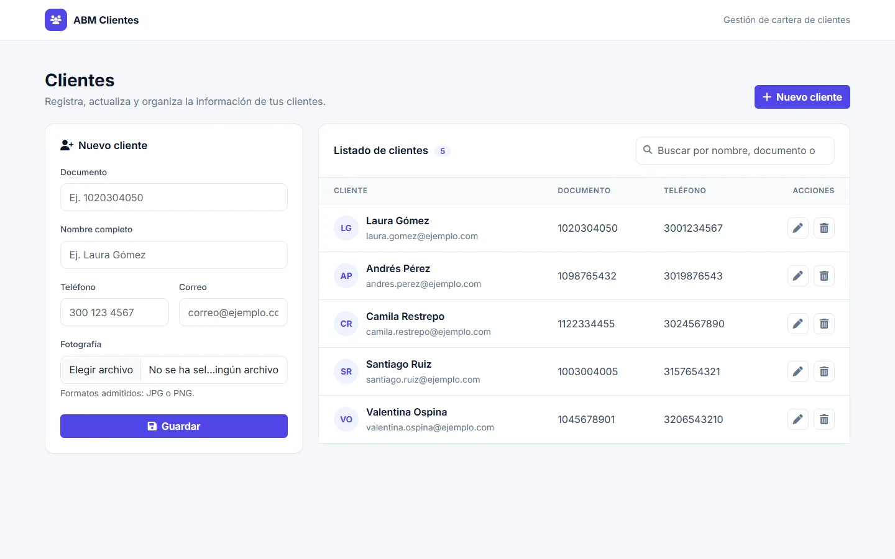

# ABM Clientes

Aplicación para dar de alta, modificar y eliminar clientes. Está pensada para practicar los fundamentos de PHP sin base de datos: la información se guarda en un archivo JSON.



## Funcionalidades

- Alta, edición y eliminación de clientes desde una sola pantalla, con confirmación antes de borrar.
- Búsqueda en vivo por nombre, documento o correo.
- Carga de fotografía (JPG o PNG) con reemplazo de la imagen anterior; si no hay foto se muestran las iniciales.
- Persistencia en `archivo.txt` en formato JSON.

## Tecnologías

PHP · JSON · Bootstrap 5 · Font Awesome

## Uso

```bash
php -S 127.0.0.1:8000
```

Y abre `http://127.0.0.1:8000`.

---

Desarrollado por [Yeison García](https://github.com/Yeistyle11).
